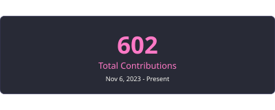

<picture>
  <source media="(prefers-color-scheme: dark) and (max-width: 600px)" srcset="./assets/profile-header-dark-mobile.svg">
  <source media="(max-width: 600px)" srcset="./assets/profile-header-light-mobile.svg">
  <source media="(prefers-color-scheme: dark)" srcset="./assets/profile-header-dark.svg">
  
</picture>

  <a href="https://prakash-palsaniya.vercel.app/">Portfolio &#8599;</a>&nbsp; &middot; &nbsp;
  <a href="https://www.linkedin.com/in/prakash-palsaniya">LinkedIn &#8599;</a>&nbsp; &middot; &nbsp;
  <a href="mailto:prakash8290682001@gmail.com">Email &#8599;</a>&nbsp; &middot; &nbsp;
  <a href="https://prakash-palsaniya.vercel.app/Prakash-Palsaniya-Resume.pdf">Resume &#8599;</a>

I'm an IT student at NIT Srinagar, graduating in 2027. I build backend APIs and applications with LLMs. Lately, that's meant working on PDF retrieval, live seat reservations, and background workers.

## Selected work

### DocuMind &nbsp; / &nbsp; [Live](https://docu-mind-alpha-topaz.vercel.app/) &middot; [Code](https://github.com/PrakashPalsaniya/Docu-Mind)

Ask questions about PDFs and get answers with source citations. I built the retrieval pipeline with LangGraph, combined vector search with BM25 and reranking, and moved document processing into background workers.

LangGraph &middot; Qdrant &middot; BullMQ &middot; Redis &middot; PostgreSQL &middot; AWS S3

### Screenly &nbsp; / &nbsp; [Live](https://screenly-beta.vercel.app/)

Movie tickets with live seat selection and Razorpay checkout. Redis holds seats while users check out; MongoDB transactions protect the booking, and RabbitMQ handles confirmation emails.

Node.js &middot; Socket.IO &middot; MongoDB &middot; Redis &middot; RabbitMQ &middot; Razorpay &middot; AWS

### FinMate &nbsp; / &nbsp; [Live](https://fin-mate-zeta.vercel.app/) &middot; [Code](https://github.com/PrakashPalsaniya/FinMate)

An expense tracker with chat-based entry and a Telegram bot. I added a Gemini assistant for questions about spending, Redis caching for reports, and Excel exports.

React &middot; Node.js &middot; MongoDB &middot; Redis &middot; Gemini &middot; Telegram

### PKLinks &nbsp; / &nbsp; [Live](https://pklinks-frontend.vercel.app/) &middot; [Code](https://github.com/PrakashPalsaniya/Pklinks-micro-services)

A URL shortener I built to work through microservices. Redirects use a Redis cache; click events go through RabbitMQ to a separate analytics worker.

Node.js &middot; Express &middot; MongoDB &middot; Redis &middot; RabbitMQ &middot; Docker

## Stack

- **Backend:** Node.js, Express, Python, Socket.IO
- **Data & queues:** PostgreSQL, MongoDB, Redis, RabbitMQ, BullMQ
- **AI & retrieval:** LangChain, LangGraph, Qdrant, LLM APIs
- **Frontend & deployment:** React, Tailwind CSS, Docker, AWS

I also solve DSA problems in C++ and study system design.

  
GitHub activity

   
  

---

Open to backend and applied AI opportunities. [Get in touch](mailto:prakash8290682001@gmail.com).
