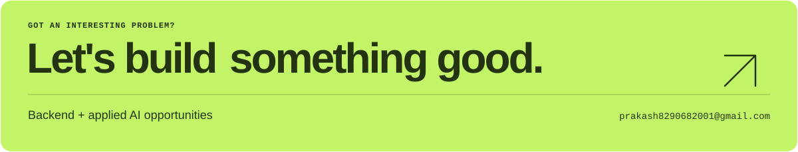

<!-- Generated by .github/generate_profile.py. Edit the generator to keep artwork and copy in sync. -->

<picture>
  <source media="(prefers-color-scheme: dark) and (max-width: 600px)" srcset="./assets/profile-header-dark-mobile.svg">
  <source media="(max-width: 600px)" srcset="./assets/profile-header-light-mobile.svg">
  <source media="(prefers-color-scheme: dark)" srcset="./assets/profile-header-dark.svg">
  <source media="(prefers-color-scheme: light)" srcset="./assets/profile-header-light.svg">
  
</picture>

  <a href="https://prakash-palsaniya.vercel.app/"><strong>Portfolio ↗</strong></a>&nbsp;&nbsp; / &nbsp;&nbsp;
  <a href="https://www.linkedin.com/in/prakash-palsaniya"><strong>LinkedIn ↗</strong></a>&nbsp;&nbsp; / &nbsp;&nbsp;
  <a href="https://prakash-palsaniya.vercel.app/Prakash-Palsaniya-Resume.pdf"><strong>Résumé ↗</strong></a>&nbsp;&nbsp; / &nbsp;&nbsp;
  <a href="mailto:prakash8290682001@gmail.com"><strong>Say hello ↗</strong></a>

I'm **Prakash**, an Information Technology student at **NIT Srinagar**, graduating in **2027**. I like the parts of an app you don't see: two people reaching for the same seat, a document being processed in the background, a redirect that needs to get out of the way.

That's where I spend my time: **backend development and applied AI**. These are a few things I've built along the way.

## 01 / The work, over time

<picture>
  <source media="(prefers-color-scheme: dark) and (max-width: 600px)" srcset="./assets/github-activity-dark-mobile.svg">
  <source media="(max-width: 600px)" srcset="./assets/github-activity-light-mobile.svg">
  <source media="(prefers-color-scheme: dark)" srcset="./assets/github-activity-dark.svg">
  <source media="(prefers-color-scheme: light)" srcset="./assets/github-activity-light.svg">
  
</picture>

[Explore my GitHub activity ↗](https://github.com/PrakashPalsaniya?tab=overview) · Refreshed daily with GitHub Actions.

## 02 / Selected builds

Four different products. Plenty of interesting problems under the hood.

<a href="https://docu-mind-alpha-topaz.vercel.app/">
<picture>
  <source media="(prefers-color-scheme: dark) and (max-width: 600px)" srcset="./assets/documind-dark-mobile.svg">
  <source media="(max-width: 600px)" srcset="./assets/documind-light-mobile.svg">
  <source media="(prefers-color-scheme: dark)" srcset="./assets/documind-dark.svg">
  <source media="(prefers-color-scheme: light)" srcset="./assets/documind-light.svg">
  
</picture>
</a>

<a href="https://docu-mind-alpha-topaz.vercel.app/"><strong>Explore DocuMind ↗</strong></a>&nbsp; · &nbsp;<a href="https://github.com/PrakashPalsaniya/Docu-Mind">Source code</a>

  
<strong>Under the hood</strong> — DocuMind

Vector search + BM25 retrieve the candidates; reranking puts the useful context first. LangGraph orchestrates the flow. BullMQ workers process documents in the background, with files in S3 and metadata in PostgreSQL.

**The flow**

PDF → background worker → hybrid retrieval → reranking → answer + sources

 

<a href="https://screenly-beta.vercel.app/">
<picture>
  <source media="(prefers-color-scheme: dark) and (max-width: 600px)" srcset="./assets/screenly-dark-mobile.svg">
  <source media="(max-width: 600px)" srcset="./assets/screenly-light-mobile.svg">
  <source media="(prefers-color-scheme: dark)" srcset="./assets/screenly-dark.svg">
  <source media="(prefers-color-scheme: light)" srcset="./assets/screenly-light.svg">
  
</picture>
</a>

<a href="https://screenly-beta.vercel.app/"><strong>Explore Screenly ↗</strong></a>

  
<strong>Under the hood</strong> — Screenly

Redis holds seats during checkout. MongoDB transactions protect bookings, Razorpay handles payments, and RabbitMQ queues confirmation emails.

**The flow**

Select seat → Redis hold → payment → booking transaction → queued email

 

<a href="https://fin-mate-zeta.vercel.app/">
<picture>
  <source media="(prefers-color-scheme: dark) and (max-width: 600px)" srcset="./assets/finmate-dark-mobile.svg">
  <source media="(max-width: 600px)" srcset="./assets/finmate-light-mobile.svg">
  <source media="(prefers-color-scheme: dark)" srcset="./assets/finmate-dark.svg">
  <source media="(prefers-color-scheme: light)" srcset="./assets/finmate-light.svg">
  
</picture>
</a>

<a href="https://fin-mate-zeta.vercel.app/"><strong>Explore FinMate ↗</strong></a>&nbsp; · &nbsp;<a href="https://github.com/PrakashPalsaniya/FinMate">Source code</a>

  
<strong>Under the hood</strong> — FinMate

Chat-based expense entry and a Telegram bot make logging quick. A Gemini assistant helps with spending questions. Redis caches reports, and Excel exports keep the data portable.

**The flow**

Chat or Telegram → expense entry → reports → assistant + Excel export

 

<a href="https://pklinks-frontend.vercel.app/">
<picture>
  <source media="(prefers-color-scheme: dark) and (max-width: 600px)" srcset="./assets/pklinks-dark-mobile.svg">
  <source media="(max-width: 600px)" srcset="./assets/pklinks-light-mobile.svg">
  <source media="(prefers-color-scheme: dark)" srcset="./assets/pklinks-dark.svg">
  <source media="(prefers-color-scheme: light)" srcset="./assets/pklinks-light.svg">
  
</picture>
</a>

<a href="https://pklinks-frontend.vercel.app/"><strong>Explore PKLinks ↗</strong></a>&nbsp; · &nbsp;<a href="https://github.com/PrakashPalsaniya/Pklinks-micro-services">Source code</a>

  
<strong>Under the hood</strong> — PKLinks

Redis caches redirects. RabbitMQ sends click events to a separate analytics worker. Built to work through service boundaries, caching, and asynchronous processing.

**The flow**

Short link → cached redirect → destination · click event → analytics worker

 

## 03 / Tools I reach for

<picture>
  <source media="(prefers-color-scheme: dark) and (max-width: 600px)" srcset="./assets/toolbox-dark-mobile.svg">
  <source media="(max-width: 600px)" srcset="./assets/toolbox-light-mobile.svg">
  <source media="(prefers-color-scheme: dark)" srcset="./assets/toolbox-dark.svg">
  <source media="(prefers-color-scheme: light)" srcset="./assets/toolbox-light.svg">
  
</picture>

 

<a href="mailto:prakash8290682001@gmail.com">
<picture>
  <source media="(prefers-color-scheme: dark) and (max-width: 600px)" srcset="./assets/contact-dark-mobile.svg">
  <source media="(max-width: 600px)" srcset="./assets/contact-light-mobile.svg">
  <source media="(prefers-color-scheme: dark)" srcset="./assets/contact-dark.svg">
  <source media="(prefers-color-scheme: light)" srcset="./assets/contact-light.svg">
  
</picture>
</a>
