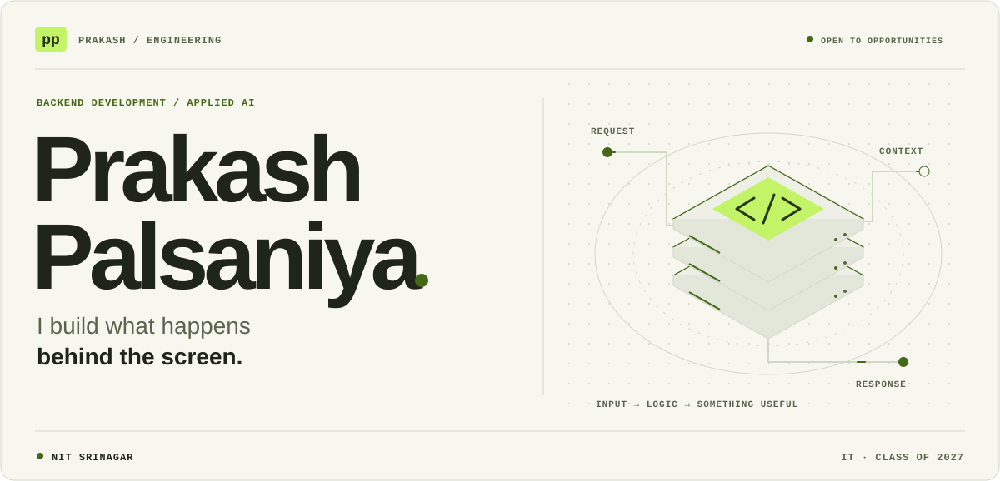
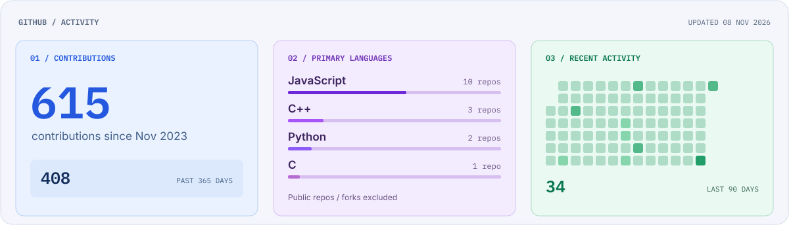
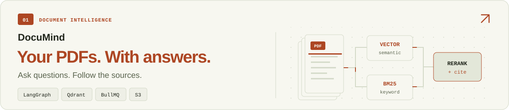
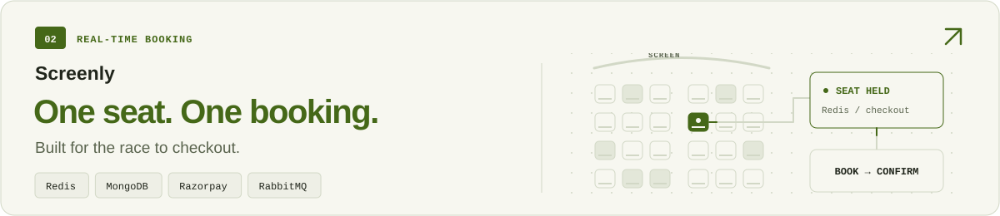
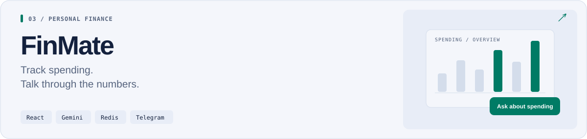
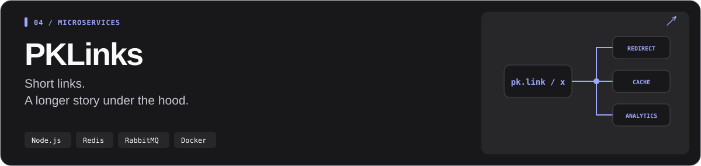
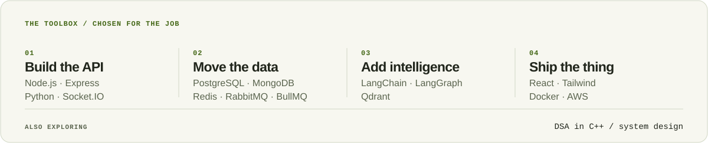

<picture>
  <source media="(prefers-color-scheme: dark)" srcset="./assets/profile-header-dark.svg">
  <source media="(prefers-color-scheme: light)" srcset="./assets/profile-header-light.svg">
  
</picture>

  <a href="https://prakash-palsaniya.vercel.app/"><strong>PORTFOLIO &#8599;</strong></a>&nbsp;&nbsp; / &nbsp;&nbsp;
  <a href="https://www.linkedin.com/in/prakash-palsaniya"><strong>LINKEDIN &#8599;</strong></a>&nbsp;&nbsp; / &nbsp;&nbsp;
  <a href="mailto:prakash8290682001@gmail.com"><strong>EMAIL &#8599;</strong></a>&nbsp;&nbsp; / &nbsp;&nbsp;
  <a href="https://prakash-palsaniya.vercel.app/Prakash-Palsaniya-Resume.pdf"><strong>RESUME &#8599;</strong></a>

I'm Prakash, an IT student at **NIT Srinagar**, graduating in **2027**. I like the parts of an app you don't see: what happens when two people book the same seat, a document takes time to process, or a redirect needs to be fast.

Most of my work is in **backend development and applied AI**.

## GitHub activity

<picture>
  <source media="(prefers-color-scheme: dark)" srcset="./assets/github-activity-dark.svg">
  <source media="(prefers-color-scheme: light)" srcset="./assets/github-activity-light.svg">
  
</picture>

[View activity on GitHub &#8599;](https://github.com/PrakashPalsaniya?tab=overview)

## Selected builds

<a href="https://docu-mind-alpha-topaz.vercel.app/">
<picture>
  <source media="(prefers-color-scheme: dark)" srcset="./assets/documind-dark.svg">
  <source media="(prefers-color-scheme: light)" srcset="./assets/documind-light.svg">
  
</picture>
</a>

<a href="https://docu-mind-alpha-topaz.vercel.app/"><strong>Open DocuMind &#8599;</strong></a>&nbsp; &middot; &nbsp;<a href="https://github.com/PrakashPalsaniya/Docu-Mind">Source code</a>

  
Inside DocuMind

Vector search + BM25 + reranking, orchestrated with LangGraph. BullMQ workers process documents in the background; files live in S3 and metadata in PostgreSQL.

<a href="https://screenly-beta.vercel.app/">
<picture>
  <source media="(prefers-color-scheme: dark)" srcset="./assets/screenly-dark.svg">
  <source media="(prefers-color-scheme: light)" srcset="./assets/screenly-light.svg">
  
</picture>
</a>

<a href="https://screenly-beta.vercel.app/"><strong>Open Screenly &#8599;</strong></a>

  
Inside Screenly

Redis holds seats during checkout. MongoDB transactions protect bookings, Razorpay handles payments, and RabbitMQ queues confirmation emails.

<a href="https://fin-mate-zeta.vercel.app/">
<picture>
  <source media="(prefers-color-scheme: dark)" srcset="./assets/finmate-dark.svg">
  <source media="(prefers-color-scheme: light)" srcset="./assets/finmate-light.svg">
  
</picture>
</a>

<a href="https://fin-mate-zeta.vercel.app/"><strong>Open FinMate &#8599;</strong></a>&nbsp; &middot; &nbsp;<a href="https://github.com/PrakashPalsaniya/FinMate">Source code</a>

  
Inside FinMate

Chat-based expense entry, a Telegram bot, and a Gemini assistant for spending questions. Redis caches reports; Excel exports keep the data portable.

<a href="https://pklinks-frontend.vercel.app/">
<picture>
  <source media="(prefers-color-scheme: dark)" srcset="./assets/pklinks-dark.svg">
  <source media="(prefers-color-scheme: light)" srcset="./assets/pklinks-light.svg">
  
</picture>
</a>

<a href="https://pklinks-frontend.vercel.app/"><strong>Open PKLinks &#8599;</strong></a>&nbsp; &middot; &nbsp;<a href="https://github.com/PrakashPalsaniya/Pklinks-micro-services">Source code</a>

  
Inside PKLinks

Redis caches redirects. RabbitMQ sends click events to a separate analytics worker. Built to work through service boundaries, caching, and asynchronous processing.

## The toolbox

<picture>
  <source media="(prefers-color-scheme: dark)" srcset="./assets/toolbox-dark.svg">
  <source media="(prefers-color-scheme: light)" srcset="./assets/toolbox-light.svg">
  
</picture>

I also work on **DSA in C++** and study system design.

---

**Have something interesting to build?** I'm open to backend and applied AI opportunities. [Let's talk &#8599;](mailto:prakash8290682001@gmail.com).
